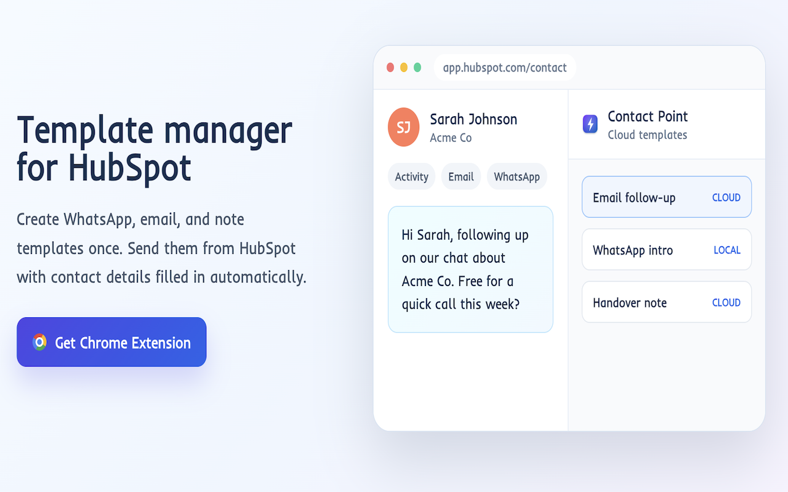

# Contact Point

A Chrome extension for people who live in HubSpot. Write your email, WhatsApp and note templates once, then send them from any contact with their name already filled in.

**[Get it on the Chrome Web Store](https://chromewebstore.google.com/detail/contact-point/lbkmdchppdedcpbodhnefeokaldihfmm)**

## What you get

- Email, WhatsApp and note templates, one click away on every contact
- Emails open as a filled-in HubSpot draft. Nothing sends without you.
- A mark on each contact showing which templates you've already used
- Export selected contacts to CSV or vCard, or copy their emails
- Dark mode for the extension and, if you want, for HubSpot too

## Run it from source

1. Open `chrome://extensions` and turn on **Developer mode**
2. Click **Load unpacked** and pick this folder
3. Open any page on `app.hubspot.com`

HubSpot changes its UI now and then, so a feature can break until the extension catches up. Dark mode for HubSpot uses the bundled [Dark Reader](https://github.com/darkreader/darkreader) engine.

## License

[AGPL-3.0](LICENSE)
